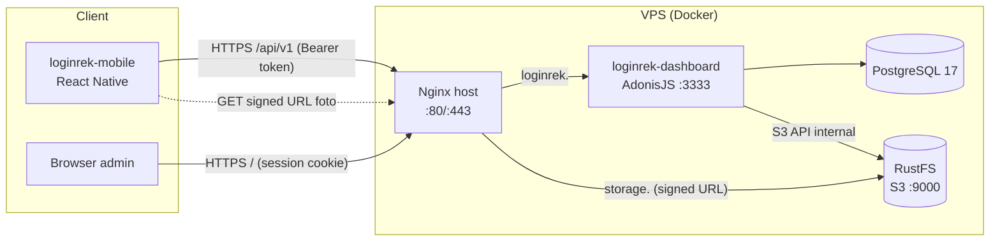
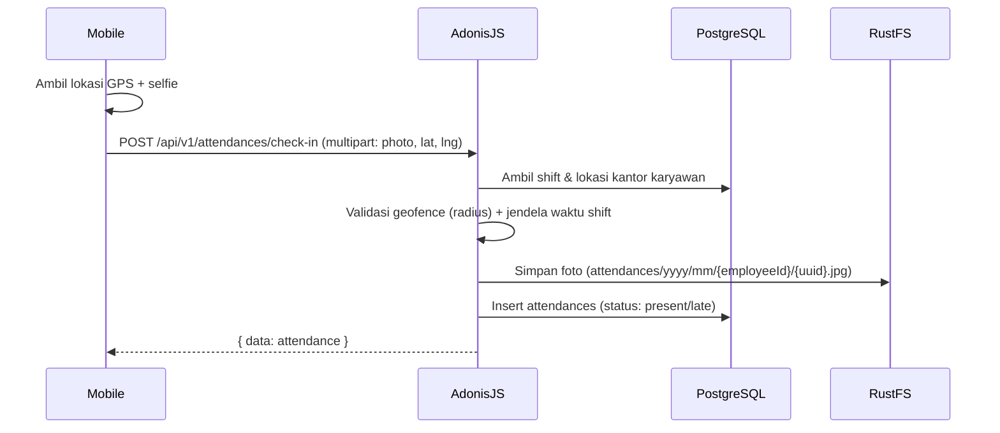

# Arsitektur — loginrek-dashboard

## Gambaran sistem



- Satu aplikasi AdonisJS melayani **dua produk**: dashboard web (Inertia) dan REST API mobile.
- Semua container hanya bind ke `127.0.0.1`; akses publik hanya lewat Nginx di host.
- Bucket RustFS **private**; client membuka file lewat **signed URL** berumur pendek
  yang ditandatangani dengan endpoint publik (`S3_PUBLIC_ENDPOINT`).

## Lapisan aplikasi

```
HTTP request
  └─ start/kernel.ts (server middleware: static, cors, vite, inertia)
      └─ router middleware: bodyparser, session, shield(CSRF), auth init
          └─ start/routes.ts
              ├─ web    : middleware.auth()                      -> Inertia page
              └─ /api/v1: middleware.forceJson() [+ auth api]   -> JSON
                  └─ controller -> validator (Vine) -> service -> model (Lucid)
                                                       └─ drive (RustFS)
                  └─ transformer -> serialize -> { data }
```

Aturan:
- **Controller** tipis: validasi input, panggil service, kembalikan transformer.
- **Service** (`app/services/*`) berisi logika bisnis (aturan keterlambatan, geofence, dll).
- **Model** hanya akses data + relasi; kolom berasal dari `database/schema.ts` (generated).

## Autentikasi

| Guard | Pengguna            | Mekanisme                         | Masa berlaku |
| ----- | ------------------- | --------------------------------- | ------------ |
| `web` | Admin/HR dashboard  | Session cookie `loginrek-session` | 2 jam (config/session.ts) |
| `api` | Karyawan (mobile)   | Opaque token `lrk_...` di tabel `auth_access_tokens` | 30 hari |

- Akun karyawan dibuat oleh admin; mobile tidak punya signup.
- Logout mobile menghapus token aktif (`POST /api/v1/auth/logout`).
- Otorisasi berbasis peran (admin, hr, karyawan) **belum** dibuat — rencana pakai `@adonisjs/bouncer`.

## Alur absensi (rencana)



## Lingkungan

| Lingkungan | Cara jalan | DB / Storage |
| ---------- | ---------- | ------------ |
| Development | `npm run dev` di host | `docker compose up -d postgres rustfs` (root) |
| Production | image GHCR via `docker-compose.yml` di VPS | container `postgres` & `rustfs` di network `loginrek` |

## Observabilitas

- `GET /health` → cek koneksi DB (dipakai healthcheck Docker & deploy `--wait`).
- Log JSON (pino) ke stdout, dirotasi Docker (`max-size 10m`, 3 file).

## Keputusan yang masih terbuka

- Role & permission (bouncer) dan struktur organisasi (departemen/jabatan).
- Penanganan absen offline di mobile (antrian lokal + sinkron).
- Backup off-server untuk PostgreSQL dan bucket RustFS.
