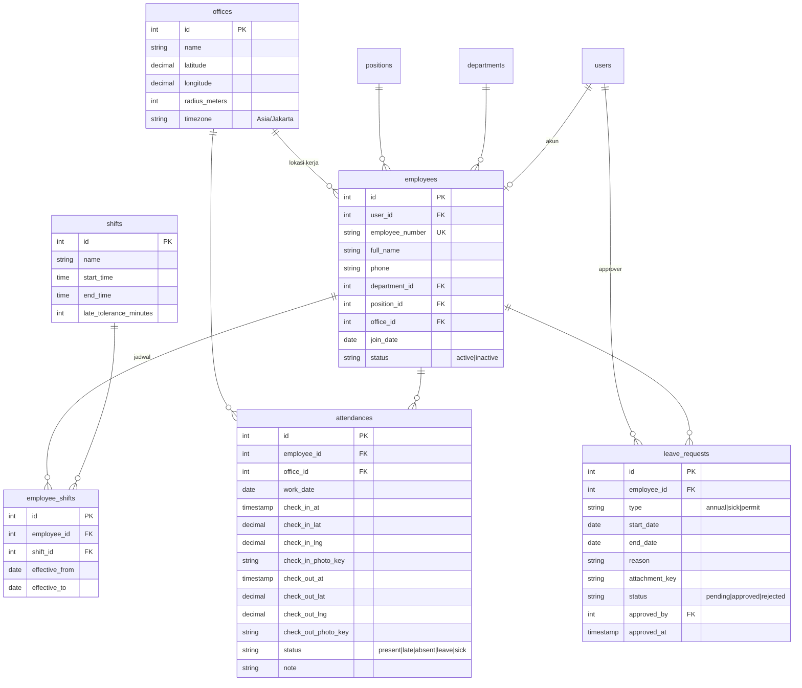

# Skema Database — loginrek

PostgreSQL 17. Sumber kebenaran adalah `database/migrations/`. Dokumen ini wajib
diperbarui di PR yang sama dengan migration.

Konvensi: nama tabel jamak `snake_case`, PK `id` (increments), FK `<entity>_id`,
`created_at`/`updated_at` timestamp (UTC), soft-delete belum dipakai.

## Tabel yang sudah ada

### `users`
| Kolom       | Tipe          | Keterangan            |
| ----------- | ------------- | --------------------- |
| id          | serial PK     |                       |
| full_name   | varchar null  |                       |
| email       | varchar(254) unique | login           |
| password    | varchar       | hash (scrypt)         |
| created_at  | timestamp     |                       |
| updated_at  | timestamp null |                      |

### `auth_access_tokens`
Token API untuk mobile (guard `api`).

| Kolom        | Tipe        | Keterangan                        |
| ------------ | ----------- | --------------------------------- |
| id           | serial PK   |                                   |
| tokenable_id | int FK → users.id (cascade) |                   |
| type         | varchar     | `auth_token`                      |
| name         | varchar null | nama device (`deviceName`)       |
| hash         | varchar     | hash token                        |
| abilities    | text        | JSON array, default `["*"]`       |
| last_used_at | timestamp null |                                |
| expires_at   | timestamp null | 30 hari sejak dibuat           |
| created_at / updated_at | timestamp |                         |

## Rancangan domain absensi (DRAFT — belum ada migration)

> Draft awal untuk didiskusikan tim. Ubah sesuai kebutuhan HR sebelum dibuat migrasinya.

Catatan desain:
- `attendances` unik per `(employee_id, work_date)`; index pada `(work_date)` untuk rekap harian.
- `*_photo_key` / `attachment_key` menyimpan **key** objek RustFS, bukan URL.
- Koordinat pakai `decimal(10,7)`; validasi jarak (haversine) dilakukan di service.
- Tabel `departments`, `positions`: `id`, `name`, timestamps.
