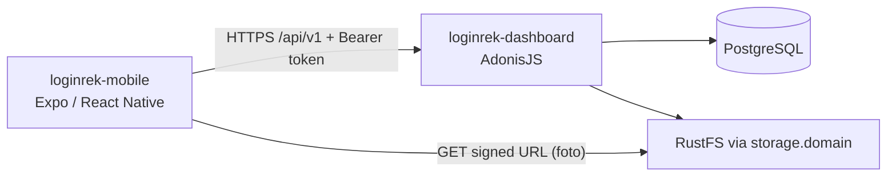

# Arsitektur — loginrek-mobile

## Posisi dalam sistem



Mobile hanya bicara dengan REST API. Tidak ada akses langsung ke database/bucket
selain membuka signed URL yang diberikan API.

## Mengapa Expo

- Tim tidak punya Mac: development di iPhone lewat **Expo Go**, build iOS lewat **EAS Build** (cloud).
- Modul resmi untuk semua kebutuhan inti (kamera, lokasi, secure storage) tersedia di Expo Go.
- Tidak terkunci: `npx expo prebuild` menghasilkan proyek native bila suatu saat dibutuhkan.

## Lapisan

```
src/app (route/screen)  ->  hook / feature logic  ->  src/lib/api.ts  ->  REST API
                                 |
                                 ├─ src/lib/token-storage.ts (expo-secure-store)
                                 └─ device API: expo-location, expo-camera
```

## Lingkungan & URL API

`src/config/env.ts` menentukan base URL:

| Situasi | URL yang dipakai |
| ------- | ---------------- |
| `EXPO_PUBLIC_API_URL` di-set (`.env.local` / `eas.json`) | nilai tersebut |
| Dev via Expo Go, HP satu Wi-Fi dengan laptop | otomatis `http://<IP laptop>:3333/api/v1` (dari host Metro) |
| Emulator Android / iOS simulator tanpa host | `10.0.2.2` / `localhost` |
| Build production | `https://loginrek.example.com/api/v1` (ganti di `env.ts` & `eas.json`) |

Mode `--tunnel` tidak meneruskan port API — set `EXPO_PUBLIC_API_URL` ke URL tunnel API
(mis. `cloudflared tunnel --url http://localhost:3333`).

## Alur utama (rencana)

1. **Root layout** → baca token dari secure store → `GET /auth/me`
   - valid → grup `(app)`; 401 → hapus token → `(auth)/login`.
2. **Login** → `POST /auth/login` → simpan token → Beranda.
3. **Beranda** → status hari ini (`GET /attendances/today`), tombol Absen Masuk/Pulang.
4. **Absen** → izin lokasi + kamera → koordinat & selfie (dikompres) →
   `POST /attendances/check-in|check-out` (multipart) → hasil (hadir/terlambat).
5. **Riwayat**, **Izin/Cuti**, **Profil** (logout → `POST /auth/logout`).

## Route (Expo Router)

| File | Layar |
| ---- | ----- |
| `src/app/_layout.tsx` | root (provider) |
| `src/app/index.tsx` | placeholder + cek koneksi API (sekarang) |
| `src/app/(auth)/login.tsx` | login |
| `src/app/(app)/_layout.tsx` | bottom tabs |
| `src/app/(app)/index.tsx` | beranda / status hari ini |
| `src/app/(app)/history.tsx` | riwayat per bulan |
| `src/app/(app)/leave/index.tsx`, `leave/new.tsx` | izin/cuti |
| `src/app/(app)/profile.tsx` | profil, logout |
| `src/app/attendance/capture.tsx` | modal kamera + lokasi |

## Library

| Kebutuhan | Pilihan | Status | Expo Go |
| --------- | ------- | ------ | :-----: |
| Routing | `expo-router` | terpasang | ✅ |
| Secure storage token | `expo-secure-store` | terpasang | ✅ |
| Kamera selfie | `expo-camera` | rencana | ✅ |
| Lokasi + deteksi mock | `expo-location` | rencana | ✅ |
| Kompres foto | `expo-image-manipulator` | rencana | ✅ |
| Server state | `@tanstack/react-query` | rencana | ✅ (JS) |
| Form | `react-hook-form` + `zod` | rencana | ✅ (JS) |

Tambah library dengan `npx expo install`. Library native di luar Expo Go → wajib development build.

## Keamanan & anti-kecurangan

- Token di secure store, dihapus saat 401.
- Kirim info lokasi palsu (`mocked` dari `expo-location` di Android) ke server.
- Validasi geofence & jendela waktu tetap **di server**.
- Foto dikompres sebelum upload (target < 500 KB).

## Build & rilis

| Profil `eas.json` | Untuk | Catatan |
| ----------------- | ----- | ------- |
| `development` | dev client (bila butuh library native di luar Expo Go) | iOS butuh Apple Developer + device terdaftar |
| `preview` | uji internal (APK Android / ad-hoc iOS) | `distribution: internal` |
| `production` | App Store / Play Store | `autoIncrement` build number |

```bash
npx eas-cli@latest login
npx eas-cli@latest init          # sekali: menautkan project, menambah projectId ke app.json
npx eas-cli@latest build --profile preview --platform android
npx eas-cli@latest build --profile production --platform ios
npx eas-cli@latest submit --platform ios
```

Rilis iOS (TestFlight/App Store) butuh **Apple Developer Program**. Workflow `deploy.yml`
saat ini hanya untuk backend; CI mobile (EAS) dibuat terpisah nanti.
